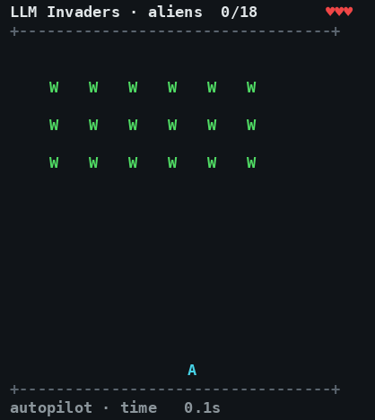
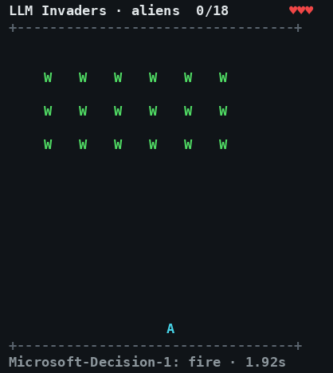

# LLM Invaders

How fast can a game run before a fast decision model stops winning it?

| Coded autopilot: clears the wave | Microsoft-Decision-1 at 20% speed: the aliens land |
| --- | --- |
|  |  |

*Both shown at real game speed. Left: the coded autopilot, deciding every 0.08 game seconds, takes one
bomb hit (the cannon bursts) and clears the wave in 62 seconds. Right: a live Microsoft-Decision-1 game.
It was played at 20% speed so it had time to think, which means the live game took five times longer
than shown; here its moves land when they would have in game time. The bottom line shows each move it
picks: "wait" in 378 of its 563 decisions, and only 39 moves, so the wave walked down past it.
Regenerate with `python3 docs/make_gif.py` (add `--player decision-1 --speed 0.2`
for a live model game, a fraction of a cent).*

A small, deterministic Space Invaders where the player is a model: the System-1 decision models
**Jev** (TypeSafe) and **Microsoft-Decision-1**, which return a probability per fixed option instead
of writing text, and **Gemma 4 E2B** on a local laptop GPU for comparison. Each decision the game
freezes, the model picks one action (left, right, fire, wait), and the game then runs on for the
model's real latency times the game speed before the action lands. Sweeping the game speed gives
each model's speed limit.

## Why this game

Robots, autonomous cars and trading systems all need decisions that land before the world moves on:
a robot arm catching a falling object, a car braking for a child, a trade placed before the other side
reacts. A brilliant answer that arrives late is a wrong answer. Today's language models are judged on
how deeply they think; this experiment asks whether **speed of thought matters as much as depth of
thought**. Space Invaders makes the trade-off measurable: every decision has a deadline, and the speed
dial turns the model's thinking time into game time.

The answer from these runs: **both matter, and speed comes first.** Latency sets a hard ceiling that no
amount of judgement gets past: a perfect coded player wins almost nothing once its decisions are more than
0.13 game seconds apart, so at Jev's 0.49 s per decision nothing wins above about a quarter of full
speed. Inside that ceiling, judgement decides: Gemma 4 E2B thought more than twice as fast as Jev but
won nothing because it only ever fired, and Microsoft-Decision-1, about as fast as Jev, won nothing
because it mostly waited. Only Jev, the fast model with the best judgement, won games. Speed is
necessary but not sufficient, which is why robots split the work: a slow model thinks deeply about
goals while a small fast policy acts every few milliseconds.

The report with the results and timings is `report.html` (published as an artifact); the raw data is
in `results.jsonl`, `ceiling.json`, `summary.json` and `cost-ledger.json`.

## Quick start

Python 3 only, no installs. In a terminal of at least 40 x 23:

```bash
python3 play.py                              # you play: ←/→ or A/D move, SPACE fires, P pauses, Q quits
python3 play.py --speed 0.3                  # more time to think: 30% of full speed
python3 play.py --seed 5                     # a different game
python3 play.py --player autopilot           # watch the coded autopilot win (free)
```

Clear all 18 aliens (`W`) before they reach your cannon (`A`), and dodge the bombs (`!`). You have one
shot (`|`) in flight at a time and three lives. When a model plays, the game keeps running while it
thinks and its move lands when the answer arrives, the same as in the experiment.

**Watch a System-1 decision model (Jev or Microsoft-Decision-1).** These run in the cloud through
OpenRouter and cost a fraction of a cent per game, counted in `cost-ledger.json`. Put your key in
`.config/openrouter.env` (git-ignored) once:

```bash
mkdir -p .config && printf 'OPENROUTER_API_KEY=%s\n' 'sk-or-...' > .config/openrouter.env
python3 play.py --player jev --speed 0.1         # about where Jev can sometimes win
python3 play.py --player decision-1 --speed 0.1
```

**Watch the local model (Gemma 4 E2B on your own GPU, free).** It runs through [Ollama](https://ollama.com):

```bash
curl -fsSL https://ollama.com/install.sh | sh    # install Ollama (Linux; macOS and Windows: download from ollama.com)
ollama --version                                 # Gemma 4 needs a recent Ollama (tested with 0.40.2)
ollama pull gemma4:e2b                           # about 4.6 GB; fits a 6 GB GPU
python3 play.py --player gemma --speed 0.3
```

The game asks Ollama at `http://localhost:11434` (its default) with thinking switched off, so each move
takes about 0.2-0.3 s on an RTX 3060 laptop GPU. If Gemma answers slowly, check that the whole model is
on the GPU (`ollama ps` should say `100% GPU`) and stop other loaded models with `ollama stop <name>`.

## Run the experiment

```bash
python3 -m unittest -v test_invaders                       # engine, harness, budget guard
./run.sh --players autopilot,always-fire,random --speeds 1 --seeds 0-19 --out baselines.jsonl
./run.sh --players jev,decision-1 --speeds 0.05,0.1,0.2 --seeds 0-2 --workers 3
./run.sh --players gemma --speeds 0.1,0.25,0.5 --seeds 0-2   # needs Ollama with gemma4:e2b
python3 report.py                                           # report.html + summary.json
```

`run.sh` reads `OPENROUTER_API_KEY` from the environment or `.config/openrouter.env` (git-ignored).
Every paid call is written to `cost-ledger.json`; paid calls stop at $1.90 (budget $2.00).

## Files

```
invaders/engine.py    the game, timed in game seconds (advance(dt) moves time; act() moves the cannon)
invaders/agents.py    coded baselines, DecisionModel (OpenRouter /api/alpha/decisions), LocalModel (Ollama)
invaders/harness.py   one game with latency charged in game time
invaders/budget.py    the cost ledger and hard stop, shared safely across processes
bench.py              the speed sweep; results.jsonl gets one line per game
report.py             summary.json and report.html (report_template.html)
```
